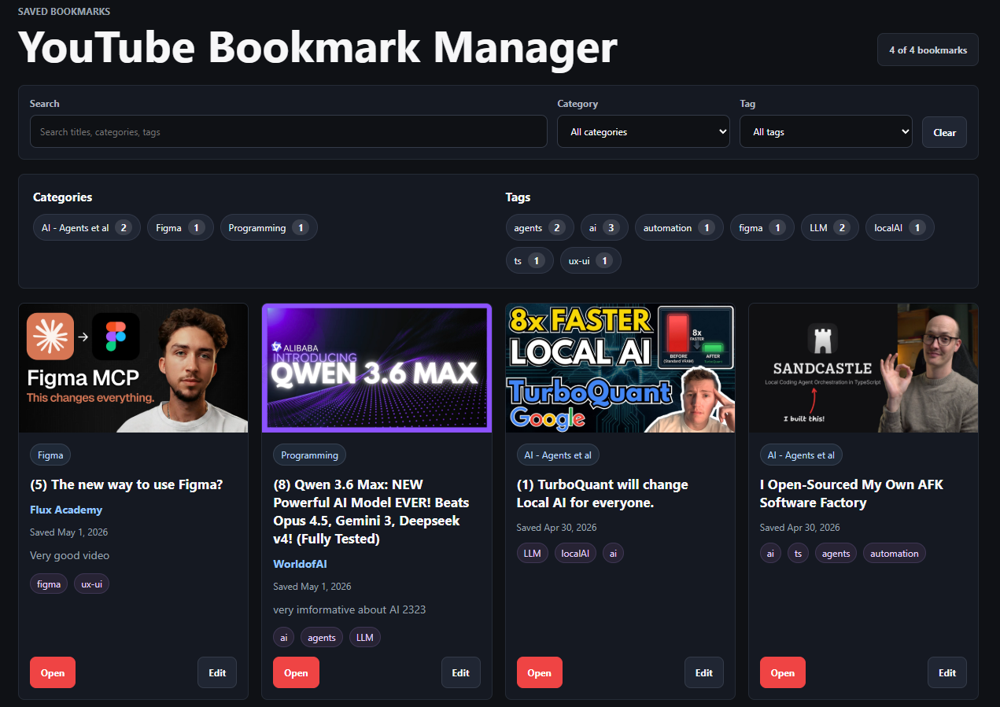

# YouTube Bookmark Manager

A simple bookmark manager extension for the Chrome Browser, for saving, organizing, and quickly revisiting your favorite YouTube videos.

## Features

- Save YouTube video links
- Organize bookmarks by category or tags
- Save a Video on a Specific timestamp with a note
- Search saved videos
- Rename or delete a tag across every bookmark that uses it
- Open saved videos directly on YouTube
- Edit a bookmarked video according to your needs
- Import and export your bookmarks as JSON
- Automatic backup to Chrome sync storage with auto-restore after reinstall
- Sync bookmarks across devices through a private GitHub gist
- Three-way merge with per-field conflict resolution and a downloadable merge log
- Clean and simple interface

## Use Case

YouTube Bookmark Manager helps you keep track of useful videos, tutorials, music, documentaries, courses, and anything else you want to watch later or reference again.

Instead of losing links in browser bookmarks, chats, or notes, you can store everything in one organized place.

## Keeping your data safe

Your bookmarks live in Chrome extension storage on your device. The extension protects them in three ways:

- **Sync backup.** Every change is mirrored to Chrome sync storage, so bookmarks survive a reinstall and follow your Google account when Chrome Sync is on.
- **Export / Import.** Download your full collection as a JSON file and restore it on any device at any time.
- **GitHub gist sync.** Optionally connect a GitHub personal access token and push/pull your bookmarks through a secret gist to move them between computers.

Deleting all bookmarks clears both local storage and the sync backup, so export first if you want a copy.

## Managing tags

**Manage tags** next to the Tags chips lists every tag with how many bookmarks use it:

- **Rename** updates the tag on all bookmarks that use it. Renaming onto an existing tag merges the two, keeping the existing spelling.
- **Delete** removes the tag from every bookmark. A bookmark left with no tags gets `generic topic`, which is the fallback tag and cannot be renamed or deleted.
- Both operations update the bookmarks' timestamps, so the change is merged and pushed like any other edit.

## Merging bookmarks across machines

Connect a gist on every machine (Sync settings → token with the `gist` scope). After that the manager merges instead of overwriting:

- **Sync now** pulls the gist, merges it with this device, then pushes the result back. With *Sync automatically* on, this also happens when the manager opens and shortly after an edit or delete.
- The merge is three-way: the extension remembers the last synced copy of every bookmark, so it can tell which side changed a title, category or note. Tags merge as a set: additions from either side are kept and removals propagate.
- **Conflicts** (both machines changed the same field) open a dialog with the local value, the other machine's value and the last synced value. Pick a value per field, use *Use mine/theirs everywhere*, then **Apply and sync**. Cancelling changes nothing.
- **Deletes propagate.** Deleting a bookmark records a tombstone that is pushed with the next sync, so the other machine does not bring it back. Delete-vs-edit becomes a conflict you decide.
- **Merge log.** Every sync that changes something writes `yt-bookmarks-merge-YYYY-MM-DD-HHmm.md` (Downloads, unless you turn off *Save a merge log file after each sync*). The same report is available from **Merge log** on the dashboard. It lists what was added, removed, updated, and how each conflict was resolved, so you can repair anything by hand.

The gist is a single file, so two machines syncing at the exact same moment can race. The extension re-reads the gist before writing and retries once; if the file keeps changing it asks you to sync again rather than overwriting blindly.

## Installation

Soon to be found on the Chrome Web Store.
Till then,
1. Clone the repo
2. Set Chrome to dev mode
3. From the Chrome extensions: "Load Unpacked" and choose the directory of the repo.
